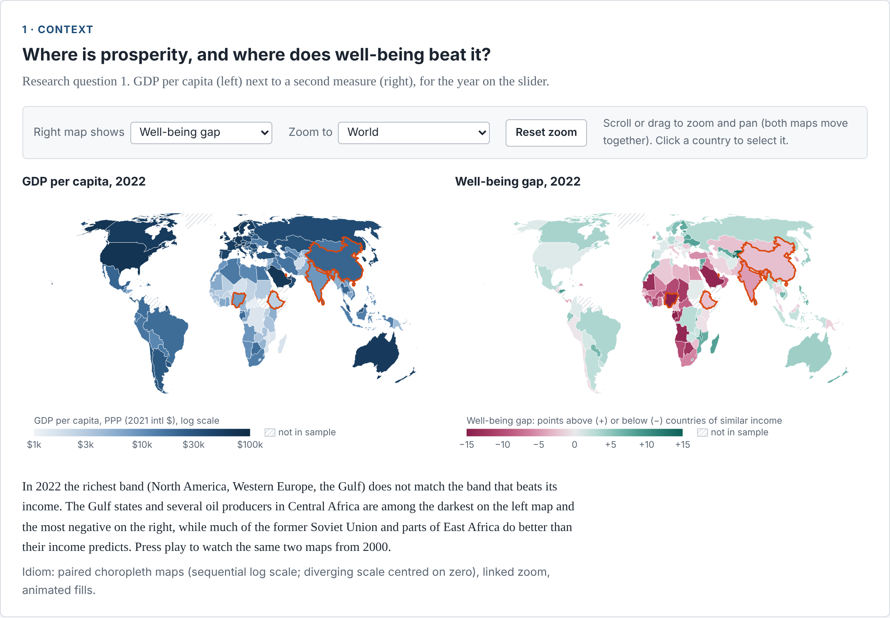
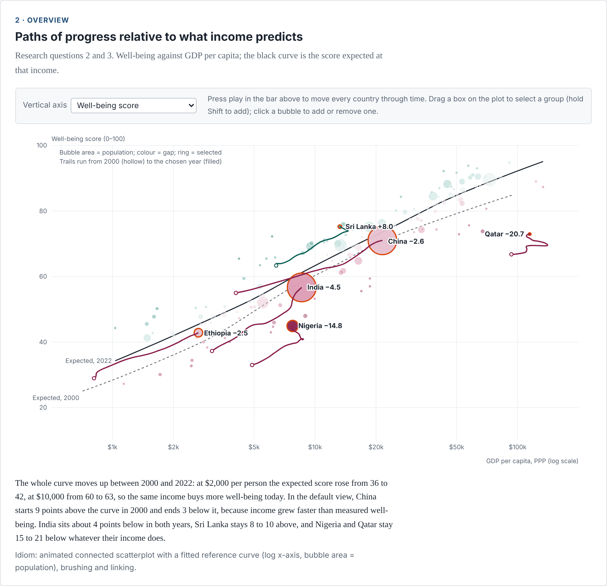
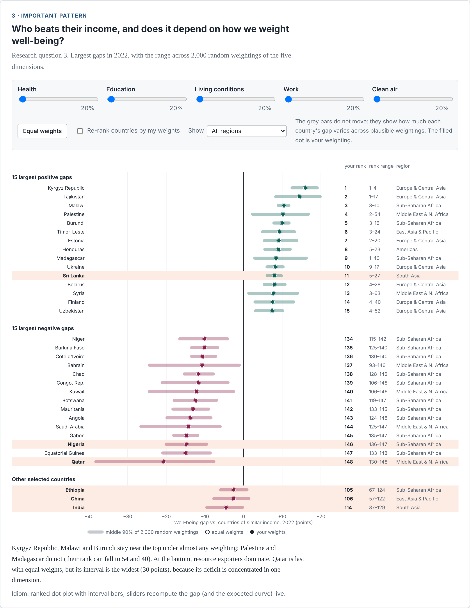
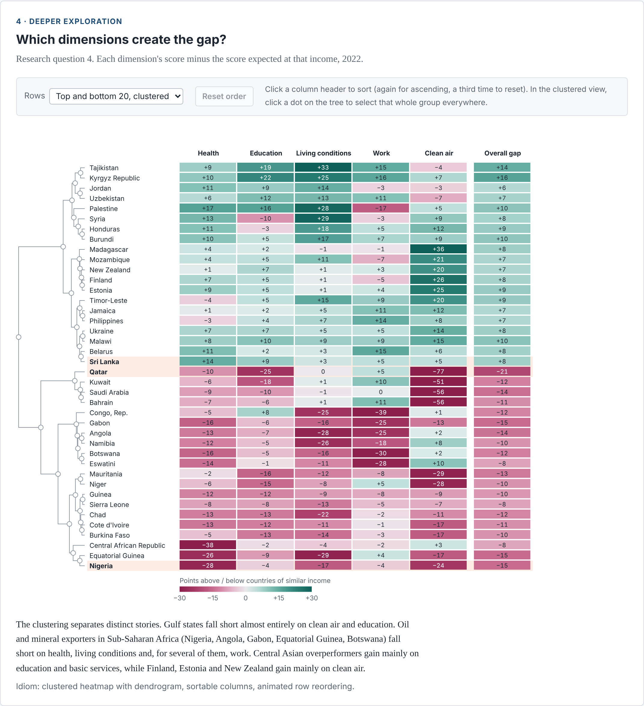
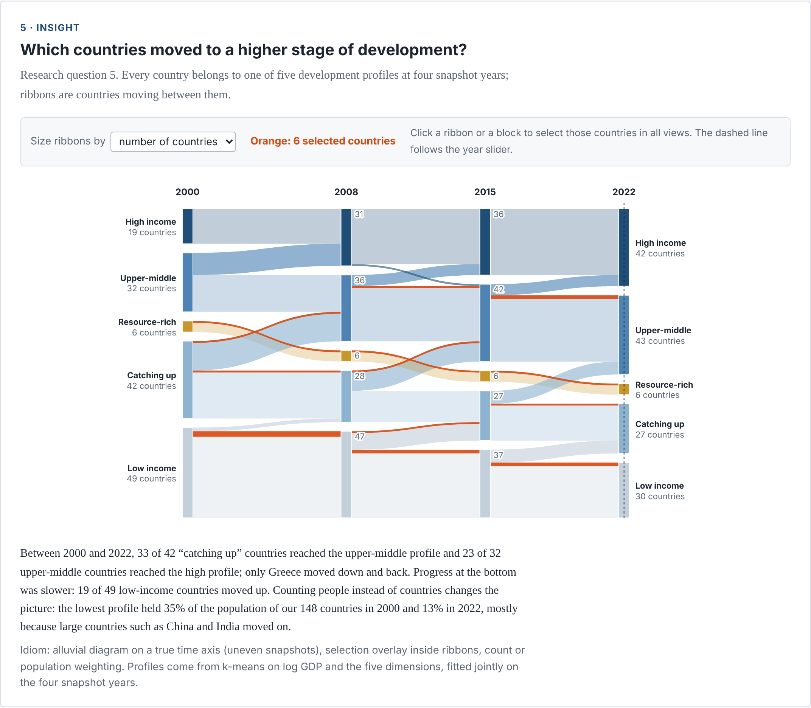

# Economic Growth and Human Well-being: Visualizing Paths of Progress Across Countries

STATS 401 final project report. Luyu Su and Yifan Zuo. Website: https://yyiffann.github.io/stats401-final-project/

## Introduction

GDP per person is the default yardstick of national progress, yet income says little about whether people are healthy, schooled, supplied with water and electricity, in work and breathing clean air. If well-being follows income closely, growth is a fair proxy for progress. Where it does not, policy makers and students of development want to know which countries are ahead of their income, which are behind, and why.

Our key idea is a derived measure, the **well-being gap**: a country's well-being score minus the score expected for its income in that year. Every view in the project answers a different question about that gap. The five research questions are: (1) how does prosperity vary across countries and over time; (2) how have countries followed different development paths; (3) how strongly is income associated with well-being, and who departs from it; (4) which dimensions explain the departures; (5) which countries moved to a higher stage of development.

The intended audience is students, researchers and general readers interested in international development. Visualization suits these questions because they are comparative and spatial (where?), temporal (how did it change?), relational (income against well-being) and multidimensional (which of five dimensions?). A table of 3,404 country-years cannot show a curve shifting over time or a heatmap cluster of causes; coordinated interactive views can.

## Method

**Data.** We integrated four public sources: World Bank World Development Indicators (GDP per capita in PPP, population, life expectancy, under-5 mortality, unemployment, vulnerable employment, basic water, sanitation, electricity access, PM2.5 exposure, CO2 per capita), the UNDP Human Development Report 2023/24 time series (mean and expected years of schooling), the World Happiness Report ladder score (used only for validation) and Natural Earth country shapes. Raw files are downloaded by `scripts/01_download_data.py` into `data/raw/` (about 95,000 country-year values in 11 WDI files, a 206 by 1,076 UNDP table, 2,359 happiness records).

**Cleaning.** `scripts/02_build_dataset.py` joins everything on ISO-3 codes into one country-year panel, keeps the years shared by all sources (2000-2022) and sovereign countries with at least one million people. Interior gaps were linearly interpolated; edge gaps were carried forward up to six years for slow-moving coverage indicators and three for the rest (734 cells, each row carries an `n_imputed` count). Ten countries without GDP data or with more than one missing indicator in a year were dropped. The result is 148 countries by 23 years = 3,404 rows.

**Transformation and analysis.** Each indicator was rescaled to 0-100 with fixed goalposts (UNDP HDI bounds where they exist, log scales for child mortality and PM2.5, the WHO guideline of 5 micrograms per cubic metre as the best air quality), so scores are comparable across years. Indicators form five dimensions (health, education, living conditions, work, clean air); the well-being score is their mean. For each year we fitted a LOWESS curve of the score on log GDP per capita; the gap is the vertical distance from this curve, and the same is done per dimension. To test robustness we recomputed all 2022 gaps under 2,000 random Dirichlet weightings and stored the 5th to 95th percentile of each country's gap and rank. Development profiles come from k-means (k = 5) on log GDP and the five dimensions, fitted jointly on 2000, 2008, 2015 and 2022 so a profile means the same thing in each year. As validation, the score correlates with World Happiness Report life satisfaction at r = 0.78 across 2,053 country-years, and the income-adjusted gap correlates with income-adjusted life satisfaction at r = 0.28.

**Implementation.** The site uses plain HTML, CSS and JavaScript with D3.js v7 and topojson-client, published on GitHub Pages. All views read one shared state (year, selected countries, weights, display options) in `js/common.js`. Figure 3 recomputes the expected curve in the browser using a JavaScript port of the LOWESS algorithm (`js/lowess.js`), which reproduces the Python values to within 0.01 points.

## Results

**Figure 1: paired choropleth maps (context).** GDP per capita sits next to a switchable measure (the well-being gap by default; score, any dimension gap or development profile also available). Users move the year slider or press play, zoom and pan both maps together, jump to a region, and click countries to select them. The richest band (North America, Western Europe, the Gulf) does not coincide with the band that beats its income: the Gulf states and Central African oil producers are among the darkest on the left and the most negative on the right, while much of the former Soviet Union and parts of East Africa outperform.

**Figure 2: animated connected scatterplot (overview).** Every country is a bubble placed by GDP per capita and well-being; the black curve is the expected score at that income. The year slider moves all bubbles and the curve; selected countries leave trails from 2000. Users can switch the vertical axis to the gap, brush a region of the plot to select a group, and click bubbles. The whole curve rose: at $2,000 per person the expected score went from 36 to 42, at $10,000 from 60 to 63. China started 9 points above the curve in 2000 and ended 3 below, India stayed about 4 below, Sri Lanka 8 to 10 above, and Nigeria and Qatar 15 to 21 below.

**Figure 3: ranked dot plot with intervals (important pattern).** Shows the 15 largest positive and negative gaps in 2022, with the middle 90% of 2,000 random weightings as a bar. Five sliders let users set their own weights; a filled dot shows the gap under those weights, recomputed live, and users can re-rank by their weights, filter by region, and see selected countries from other views. The Kyrgyz Republic, Malawi and Burundi stay near the top under almost any weighting; Palestine and Madagascar do not (ranks can fall to 54 and 40). Qatar is last with equal weights but has the widest interval (30 points).

**Figure 4: clustered heatmap with dendrogram (deeper exploration).** Rows are the 20 largest positive and negative gaps, ordered by Ward clustering of their five dimension gaps; columns are dimensions. Users sort by any column with animated row transitions, switch the rows to their own selection, and click a branch of the tree to select that cluster everywhere. Gulf states fall short almost entirely on clean air and education; Sub-Saharan resource exporters on health, living conditions and work; Central Asian overperformers gain on education and basic services.

**Figure 5: alluvial diagram of development profiles (insight).** Ribbons show countries moving between the five profiles in 2000, 2008, 2015 and 2022, on a true time axis. Users size ribbons by countries or population, click ribbons or blocks to select those countries in every view, and see their current selection as an orange overlay inside the ribbons. 33 of 42 "catching up" countries reached the upper-middle profile and 23 of 32 upper-middle countries reached the high profile; only Greece moved down and back. Weighted by people, the lowest profile held 35% of the population in 2000 and 13% in 2022.

**Coordination.** Hovering a country highlights it in all views; selection is shared; the year slider drives Figures 1, 2 and a marker in 5; a guided tour presets four findings and then hands control to the user.

## Discussion

**What-Why-How.** *Figure 1*: What: country-year GDP and gap (quantitative, geographic). Why: locate and compare regions, identify trends. How: choropleth with sequential and diverging colour, animated fills, linked zoom. *Figure 2*: What: GDP, score, gap, population over time. Why: see relationship, trajectories and outliers. How: position (x, y), area (population), colour (gap), trails, brush and link. *Figure 3*: What: gap and its sensitivity to weights. Why: judge robustness of a ranking. How: aligned position, interval bars, sliders. *Figure 4*: What: five dimension gaps per country. Why: explain causes, find groups. How: colour matrix, tree, sorting, group selection. *Figure 5*: What: categorical profile over four time points. Why: identify transitions and who made them. How: stacked blocks, ribbons, population weighting, overlay.

**Strengths.** The views share one question and one measure, so a user can go from "Qatar is last" (3) to "because of air and education" (4) to "its profile never changed" (5). The weight sliders turn an arbitrary modelling choice into something the viewer can test.

**Weaknesses and limitations.** The score is a composite of ten indicators; PM2.5 includes natural desert dust, which penalises Gulf and Sahel countries; a GDP collapse (Syria) can produce a positive gap because earlier services persist; 2022 schooling is partly projected. Figures 3 and 4 show only 2022, while Figures 1 and 2 show all years. Colour carries both gap and profile meanings in different views, and the alluvial labels are crowded on small screens. The dendrogram is hidden when columns are sorted.

**Possible improvements.** Year-specific heatmap and sensitivity views, uncertainty from data imputation, a population-weighted version of the maps, and a small-multiple view comparing regions.

## Conclusion

Income is a strong but imperfect guide to well-being: in 2022 the gap runs from +16 (Kyrgyz Republic) to -21 (Qatar). The same income buys more well-being than in 2000. Falling short has different causes: Gulf states lose on clean air and education, Sub-Saharan resource exporters on health, living conditions and work. Overperformance is mostly basic services and schooling, and the top of the ranking is robust to weighting. Development stages are changing unevenly: most "catching up" countries reached the upper-middle profile, fewer than half of the lowest-profile countries moved up, and counting people shows how much China and India shape the global picture. For an audience, the project turns "is growth enough?" into questions they can explore themselves rather than a single number.

## Roles and responsibilities

[Adjust to what actually happened.] **Yifan Zuo**: data acquisition, cleaning and integration; well-being score, gap and sensitivity analysis; selected D3 views; interaction design and testing. **Luyu Su**: data preparation and exploratory analysis; selected D3 views; interactive features and website interface; documentation. **Both**: research questions, validation, narrative, user testing, report, poster and presentation.